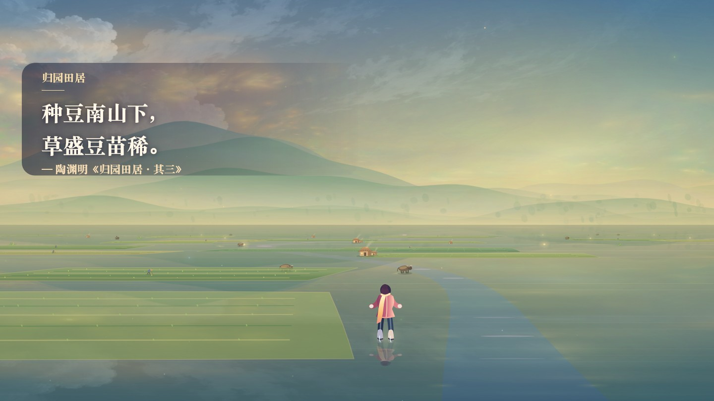
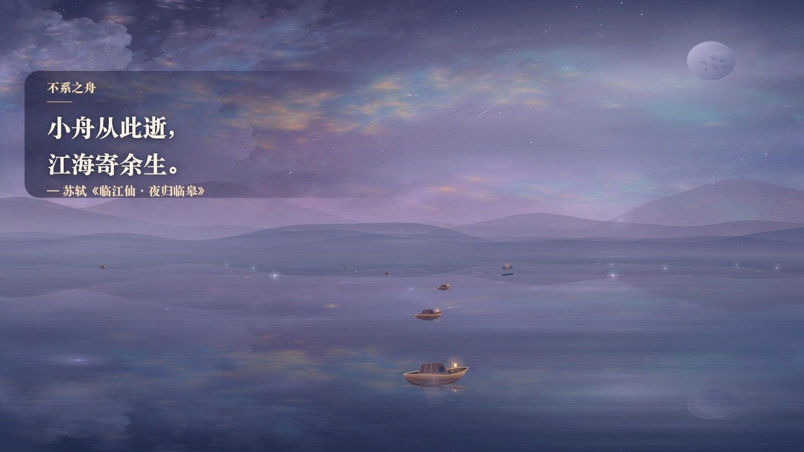

# 浮梦之境 · Reverie

一朵海棠逆着风，在你的冰刀前打了个旋。你跟着它滑进海雾，隔着冰看见一条比岛还长的影子。

这段有诗词相伴的航程约二十一分钟，之后还可以继续漫游。点「踏上冰面」，人物会缓缓向地平线滑去。你可以自己转向、加速，也可以随时停下来，看一会儿云。

**[打开在线版](https://aubreykuang.github.io/Dreamer/)** · 离线游玩时，下载整个项目，用浏览器打开 `index.html`。

下方配图取自游戏实景，每张配有对应的诗文和出处。

## 十五段航程

| 场景 | 沿途风景 | 诗句与旁白 |
| --- | --- | --- |
| 海棠渡 | 粉金晨光铺在冰上，海棠花瓣从身边飘过。 | 迟日江山丽，春风花草香。 |
| 海雾深处 | 珊瑚色与灰蓝的雾叠在一起，白鸟贴着冰面飞过。 | 气蒸云梦泽，波撼岳阳城。 |
| 北冥有鱼 | 青绿、靛蓝和藤紫的极光映入冰中，鲲浮上水面。 | 北冥有鱼，其名为鲲。 |
| 天接云涛 | 鲲与衔花的飞鱼穿过杏金云浪，蝴蝶在肩头绕一圈。 | 天接云涛连海雾，星河欲转千帆舞。 |
| 天河星原 | 星尘铺向远方，萤火虫跟着冰刀的微光飞一段。 | 银烛秋光冷画屏，轻罗小扇扑流萤。 |
| 灯火葳蕤 | 林间的树影随风轻晃，暖灯一盏盏映在冰面上。 | 平林漠漠烟如织。 |
| 蓝田日暖 | 暖阳照进青玉色的山谷，淡金薄雾贴着冰面流动。 | 蓝田日暖玉生烟。 |
| 桃源深处 | 青黛远山下，桃花簇拥溪岸。读到「落英缤纷」时，花瓣从天上成片飘落。 | 芳草鲜美，落英缤纷。 |
| 归园田居 | 南山脚下，牧童骑牛沿田埂走过，有人弯腰种田，几间茅草屋升起炊烟。 | 种豆南山下，草盛豆苗稀。采菊东篱下，悠然见南山。 |
| 不系之舟 | 月夜乘舟，循黄州、惠州、儋州的意象远行，偶尔与另一盏船灯擦肩。 | 小舟从此逝，江海寄余生。 |
| 赤壁赋 | 小舟驶过赤褐色的崖岸，明月在青碧江面上铺开碎银。 | 取之无禁，用之不竭。 |
| 春江花月夜 | 一轮亮月映在靛蓝江面，银白花枝在船边轻摇。 | 江流宛转绕芳甸，月照花林皆似霰。 |
| 李凭箜篌引 | 朱粉芙蓉和翡翠色花洲在暮紫中交替亮起，拨弦声从两岸传来。 | 昆山玉碎凤凰叫，芙蓉泣露香兰笑。 |
| 镜湖飞渡 | 远山在月雾中层层退开，月影伴你滑过湖面，再飞入霞紫云海。 | 湖月照我影，送我至剡溪。 |
| 寒江独钓 | 墨色山峦退入留白，雪中一叶孤舟，远处的湖心亭淡得像一个墨点。 | 孤舟蓑笠翁，独钓寒江雪。 |

「不系之舟」里，另一盏船灯会从左侧慢慢经过。用方向键或触屏转向靠近，对面的行人会举灯回应，滑行手记也会记下这次相遇。继续顺流则会读到原来的旁白。

> 我自飘零 
> 亦是行人

| 海雾深处 | 北冥有鱼 |
| --- | --- |
|  |  |

| 天接云涛 | 天河星原 |
| --- | --- |
|  |  |

| 灯火葳蕤 | 蓝田日暖 |
| --- | --- |
|  |  |

| 桃源深处 | 归园田居 |
| --- | --- |
|  |  |

| 春江花月夜 | 李凭箜篌引 | 镜湖飞渡 |
| --- | --- | --- |
|  |  |  |

「寒江独钓」在柳宗元《江雪》之后接入张岱《湖心亭看雪》的两句。念到「湖心亭一点」，远亭从白雾里渐渐浮出来。

驶出赤壁时，字幕会留出一段空白。在「春江花月夜」读到「花影散在水上」后，可以按住刹停，等小舟停稳两秒，让碎光在水里合成花影。一路顺流，碎光会在下一段旁白出现时拉成银带。打开「手记 → 重访航段 → 春江花月夜」可以换一种走法，两种旁白会分别留在手记里。

「桃源深处」在花雨过后转入春夜，李白《春夜宴从弟桃花园序》精选的五段依次浮现。读到「开琼筵以坐花，飞羽觞而醉月」，月下再落一阵花雨。《诗经》的《蒹葭》《桃夭》《采薇》分别出现在海雾深处、桃源深处和归园田居。

滑进桃源时，可以贴左岸看桃树下的石径，也可以往右看漂着落花的浅湾。两岸各有一页手记。沿溪心滑过也能读完原来的诗文。

[查看「蓝田日暖」手机竖屏画面](reverie-jade-mobile.jpg)

换景时，远处的云色、近处的薄雾和冰上的倒影会一起慢慢过渡。冰上能看见掠过的碎光，星原的星尘斜铺过夜空，林间的萤光聚在树影与暖灯之间。

## 扶摇直上

> 大鹏一日同风起，扶摇直上九万里。
>
> ——李白《上李邕》

滑到云海后段，诗句出现时，你会自动随大鹏离开冰面。仙鹤会伴飞一段，再散入远处。左右仍可转向，向上迎风抬升，向下俯瞰。约 22 秒后，你会自然落回冰面，继续滑向星原。

想直接体验，打开「手记」→「重访航段」→「扶摇」。

## 冰面上的小问候

97 段旁白随滑行展开，古诗词、短叙事和小问题穿插出现。每段停留约 8–15 秒，留一会儿空白才翻到下一句。靠近冰面光点时，还可能遇到 24 句轮流出现的短问候，每句约停留 6 秒。

- 「今天，有哪一刻让你松了口气？」
- 「有些烦恼像风，拂过就好，不必把它留在心里。」
- 「想在这一盏灯旁，多留一会儿吗？」

可以在心里想一想，也可以直接滑过去。滑行或乘舟时按住刹停，当前诗句会留在画面上，松开后接着计时。「不系之舟」里，可以转向靠近擦肩的船灯，也可以留在远处看两盏灯之间的江面。右上角「？」→「滑行手记」可回看已读剧情和诗词出处，也能从海棠渡重新出发。打开手记、说明或换梦面板时，航程会暂停。

## 操作

| 操作 | 键盘 | 触屏或界面 |
| --- | --- | --- |
| 转向 | ← / → 或 A / D | 向左或向右拖动并按住 |
| 加速、刹停 | ↑ / ↓ 或 W / S | 上下拖动，或按住「加速」「刹停」 |
| 蹬冰提速 | 空格 | 点「蹬冰」 |
| 乘风抬升、俯瞰 | ↑ / ↓ 或 W / S | 上下拖动，或按住「抬升」「俯瞰」 |
| 换梦 | Enter | 点「换一个梦」 |
| 切换自由漫游 | G | 「换一个梦」→「自由漫游」 |
| 隐藏或恢复界面 | H | 点右上角观景按钮 |
| 留影 | P | 点「留影」，下载 PNG 并收进手记 |

在「手记」的「重访航段」可以跳到任意一段。每当一段诗句出现，浏览器会记住这里，下次打开可选「继续上次航程」。在「换一个梦」输入「鲸鱼」「月亮」「极光」或「花海」可自由漫游，点「回到航程」接着读。

在桃源选岸后或春江倒影还在时留影，手记会并排展示两种走法各自的照片。只有一张时，可点「重访分岔」回到选择前，再拍另一张。

## 无边冰原

按住 ← / →（或 A / D）可以一直向同一侧滑。手机上，向一侧拖动后保持按住，松手就会平缓回正。冰纹、光点、树与灯的位置随地图延伸，横滑时近景会比远山移动得更快。

按 G 进入自由漫游后，左右键改变朝向，可以绕行、掉头或倒滑。向上加速，向下先减速再倒滑。手机上拖动转向，上下拖动或按住屏幕按钮来调速。再次按 G 回到航程，继续原来的诗词进度。

读完「寒江独钓」的最后一句后，依然可以一直向前或向两侧探索。滑行一段距离后，天光、地貌和配乐会渐渐变换，已读过的诗句仍可在手记里回看。

## 配乐与冰面音效

首次点按或按键后，配乐和环境音会响起。海棠渡的清亮旋律慢慢淡入海雾的低音，北冥的音色更深，云海的旋律更轻，星夜的音符更疏。林间的和声放缓，滑进蓝田后旋律重新明亮起来。桃源的配乐底下还能听见溪水声，靠近水湾时更明显。

转向时，刮冰声会轻轻偏向转弯的一侧。蹬冰像几颗碎霜接连弹开，冲刺带起一阵风，刹停则是逐渐变轻的冰面摩擦。经过光点，会听到一声轻音，冰上散开一圈光。

右上角扬声器可关闭全部声音。想只听配乐，可以在「？」里取消勾选「冰面音效」。

[玩法探索与试玩记录](docs/gameplay-exploration.md)

## 本地运行

下载整个项目后，用浏览器打开 `index.html` 即可，无需安装依赖。保留同目录下的 `style.css`、`js/` 和 `assets/`。场景由 Canvas 2D 绘制，配乐、风声和冰刀声由 Web Audio 合成。GitHub Pages 从 `main` 分支根目录提供游戏。

| 路径 | 内容 |
| --- | --- |
| `index.html`、`style.css` | 页面结构、脚本加载顺序和界面样式。 |
| `js/chapters.js`、`js/route.js`、`js/journey.js` | 诗词与章节数据、航程推进、梦境切换。 |
| `js/scene-state.js`、`js/landscape.js`、`js/scenery.js`、`js/render.js` | 画面状态、天光与冰面、沿途地貌、人物与每帧绘制。 |
| `js/storage.js`、`js/journal-ui.js`、`js/photo.js` | 本地设置、手记和留影。 |
| `js/audio.js`、`js/controls.js`、`js/main.js` | 配乐和音效、滑行操作、键鼠与触屏绑定和启动。 |
| `assets/sky-atlas.js` | 天空纹理，使用数据 URL 以支持从本地文件留影。 |
| `perf/serve.py` | 生成临时的渲染基准页面，运行后打开终端输出的网址。 |
| `README.md` | 航程、诗词、玩法和操作说明。 |
| `reverie-*.jpg` | 十五个场景、扶摇飞行和手机竖屏的实机渲染画面。 |
